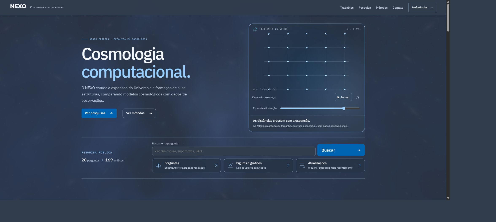
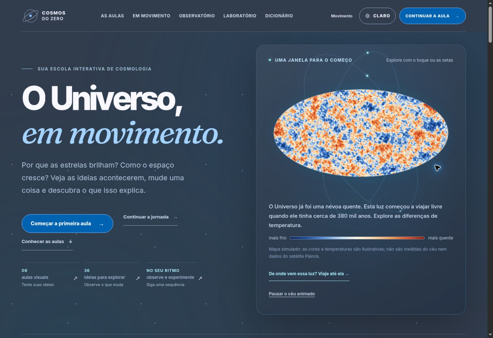

# Azul de referência — NEXO e Cosmos do Zero

Paleta aplicada a partir da referência visual enviada em 3 de novembro de 2026.

| Uso | Cor |
|---|---|
| Fundo escuro | `#313C4C` |
| Ação principal | `#0063B1` |
| Superfície | `#263345` |
| Texto principal | `#F4F7FB` |
| Texto de destaque | `#99CFFF` |

Contrastes medidos: 10,39:1 no texto principal, 6,77:1 no secundário e 6,14:1 no botão azul com texto branco.

## Publicação e conferência

- [NEXO](https://nexoresearch.org/): fonte do PR523 em `6c09cfde66ba3212f0c78f61d8ee205f7d8acd05`; brilho ajustado pelo PR524 em `8260b800b62f7572a1196f52fb9ce67d224df8e2`. A abertura usa expansão em SVG com controle manual, pausa e reinício. Os corpos mantêm seus tamanhos enquanto as distâncias crescem. A teia saiu dessa abertura.
- [Cosmos do Zero](https://cosmos.denerpereira.com.br/): fonte do PR206 em `a722a70fd9a494f8b43c712939918d9017ad2775`; prompt reutilizável atualizado junto da paleta.
- Verificações locais: 178 testes do Cosmos, 540 do NEXO e 6 de paleta do backend aprovados. Tipos e builds aprovados.
- Conferência nos domínios publicados: fundo computado `rgb(49, 60, 76)` nos dois sites; SVG do NEXO avançou e pausou sob controle. A apresentação pública manteve 20 perguntas e 169 análises.

## Capturas reais dos sites publicados

As imagens foram conservadas sem edição. O navegador do NEXO usa GPU; a captura do Cosmos usa a alternativa gráfica disponível no navegador de conferência.

