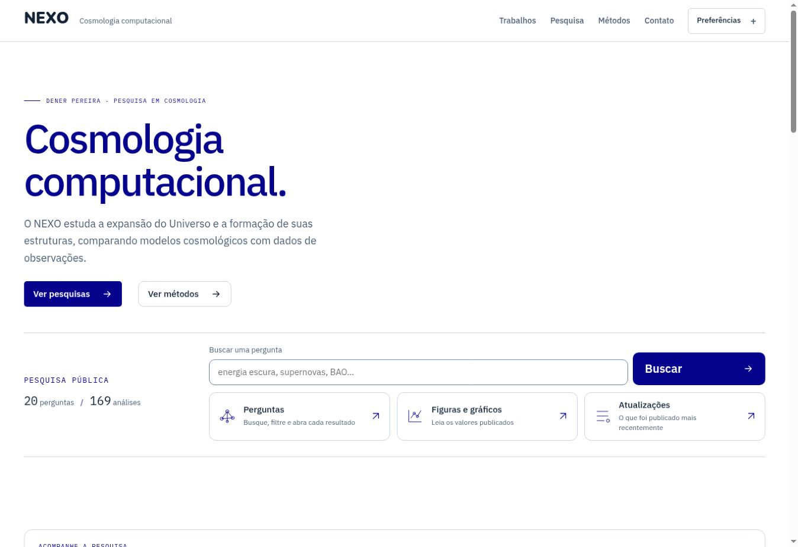
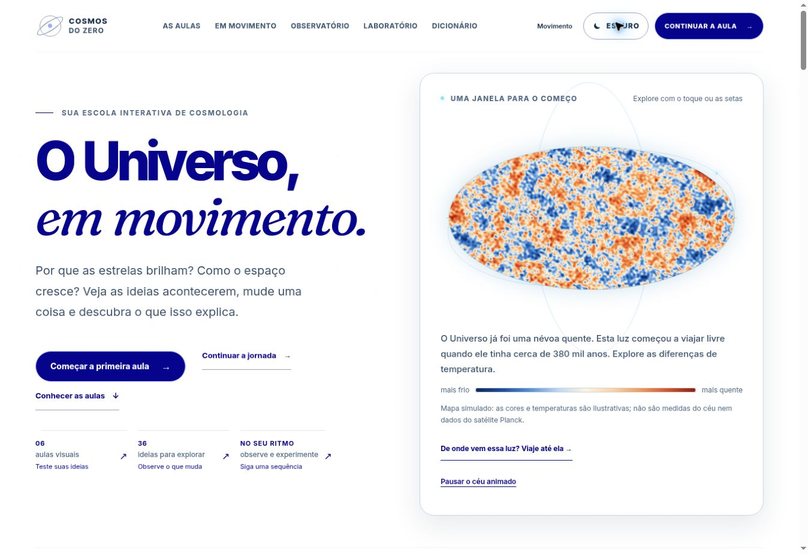

# NEXO e Cosmos — branco com Pantone 2738 C

Direção confirmada em 4 de novembro de 2026: fundo branco `#FFFFFF`, títulos e botões no azul Pantone 2738 C `#06038D`. O tema claro passa a ser o padrão; escolhas explícitas de tema continuam disponíveis.

O painel “Explore o Universo” foi removido do NEXO, incluindo os componentes exclusivos e os estilos da ilustração. A abertura usa uma coluna e mantém a busca e os atalhos da pesquisa. Os dados e a autenticação permanecem sob os contratos existentes.

## Evidência pública

| Página capturada | Fundo calculado | Título e botão principal | Painel de exploração |
| --- | --- | --- | --- |
| https://nexoresearch.org/ | `rgb(255, 255, 255)` | `rgb(6, 3, 141)` | Ausente |
| https://cosmos-do-zero.vercel.app/ | `rgb(255, 255, 255)` | `rgb(6, 3, 141)` | Não se aplica |

Capturas reais de navegador em 1348 × 926 pixels. O NEXO carregou 20 perguntas e 169 análises na conferência. O Cosmos conserva suas experiências, animações e cores científicas. Seu domínio principal, https://cosmos.denerpereira.com.br/, recebe a mesma fonte pelo workflow de publicação existente.

## Fontes e validação

- NEXO: PR [526](https://github.com/byDenoso/Pantheon/pull/526), fonte `a1e47f48a8c13bdc568e29ac2452d711de8d5ffa`; TypeScript, build, 540 testes e 6 testes de tema legado aprovados. Publicação pública [41767239891](https://github.com/byDenoso/Pantheon/actions/runs/41767239891) aprovada.
- Cosmos: PR [207](https://github.com/byDenoso/TCC/pull/207), fonte `2aef348d723da3f87ea9946a859e37b0317eb1ab`; Astro check sem diagnósticos, 178 testes e build público aprovados. O PR [208](https://github.com/byDenoso/TCC/pull/208) explicita o tema escuro na inspeção de saturação WebGL, preservando os limiares originais.
- Valor digital consultado na [referência oficial Pantone](https://www.pantonecn.com/connect/2738-C).
- A camada privada recebe o mesmo azul nos títulos e ações; não foram capturadas telas privadas nem alteradas credenciais, sessões ou dados.

| Arquivo | SHA-256 |
| --- | --- |
| `nexo-publicado.jpg` | `62e5d16dd2370ae52df5e3fce2a72e89ecf549a9fe6015a9b767f4dee39a4c73` |
| `cosmos-publicado.jpg` | `56c1209f3f43c145a58a45009298f239235673744debbeb938b19410ba486d08` |
